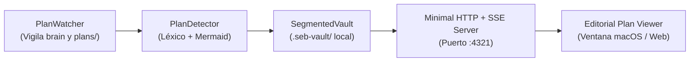

# Protocolo de Instalación para Agentes de IA (`deckseb`)

Si un usuario solicita a un agente de codificación de IA (por ejemplo Antigravity, Claude Code o Codex) instalar, configurar o utilizar `deckseb`:

> [!NOTE]
> `deckseb` es un visor de planes ultraminimalista e instantáneo con renderizado en vivo de Markdown GFM y diagramas Mermaid SVG para el ecosistema `*seb` ([`hubseb`](../hubseb), [`crewseb`](../crewseb), [`memoseb`](../memoseb)).
> Es **100% opcional** y no bloqueante: todos los agentes, subrutinas CLI y modelos de IA continúan funcionando plenamente sin su presencia.

---

## 🏛️ Arquitectura del Visor

El flujo de procesamiento opera de manera puramente reactiva y no intrusiva:



En cuanto el agente crea o actualiza un archivo de plan (`implementation_plan.md`, `plans/*.md`, artefactos en `.gemini/antigravity-cli/brain/` o `.seb-vault/`), `deckseb` abre o actualiza automáticamente la ventana editorial con soporte completo para alertas GitHub, tablas y diagramas Mermaid.

---

## Opción A: Ejecución Directa o Instalación Rápida vía npm (Recomendada)

```sh
# Ejecutar directamente sin compilar ni instalar localmente:
npx deckseb watch

# O instalar de manera global en el entorno:
npm install -g deckseb
deckseb setup
```

---

## Opción B: Instalación desde Código Fuente (Desarrollo Local)

### 1. Construir `hubseb` previamente (si existe localmente)
Si la carpeta adyacente `../hubseb` está presente, compilarla:
```sh
cd ../hubseb && npm install && npm run build && cd ../deckseb
```

### 2. Instalar dependencias y compilar el paquete CLI
```sh
npm install
npm run build
npm test
```

### 3. Verificar la suite de pruebas del backend nativo (Rust)
```sh
(cd src-tauri && cargo test)
```

### 4. Enlazar el binario CLI y registrar en la topología de `hubseb`
```sh
chmod +x dist/cli/deckseb.js
ln -sf "$(pwd)/dist/cli/deckseb.js" ~/.local/bin/deckseb
deckseb setup
```

### 5. Verificar el estado del visor y el ecosistema
```sh
deckseb status
hubseb ls
hubseb doctor
```

---

## ⌨️ Comandos CLI Disponibles

| Comando | Acción |
|---|---|
| `deckseb` / `deckseb watch` / `deckseb ui` | Inicia el visor reactivo en segundo plano (`:4321`), vigilando planes y emitiendo actualizaciones vía SSE. |
| `deckseb <archivo.md>` / `deckseb show <archivo.md>` | Abre de forma inmediata el plan especificado en la ventana editorial. |
| `deckseb detect <archivo.md> [--json]` | Analiza un archivo Markdown y extrae la clasificación del segmento y bloques Mermaid. |
| `deckseb status [--json]` | Informa sobre el estado del servidor, cantidad de planes y registro en la topología. |
| `deckseb setup` | Registra `deckseb` como nodo hoja (`ui.deck`, `artifacts.organizer`) en `~/.config/hubseb/topology.json`. |
| `deckseb purge` | Remueve `deckseb` de la topología sin alterar los demás paquetes del ecosistema. |

---

## 🧪 Suite de Verificación Completa

Para garantizar que el código compila limpiamente y todas las pruebas pasan sin regresiones:

```sh
npm run typecheck
npm test
npm run build
(cd src-tauri && cargo test)
```

O en una sola orden encadenada:

```sh
npm run typecheck && npm test && npm run build && (cd src-tauri && cargo test)
```

---

## Desconexión / Purga Limpia (Opcional)

Dado que `deckseb` es un nodo observador no intrusivo (`ui.deck`), puede desvincularse de la topología en cualquier momento sin afectar la ejecución de ningún agente:

```sh
deckseb purge
```
