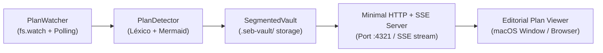

# deckseb

Visor editorial de planes ultraminimalista e instantáneo con renderizado reactivo de Markdown GFM y diagramas Mermaid para el ecosistema `*seb` ([**hubseb**](https://github.com/PahesebPJ/hubseb), [**crewseb**](https://github.com/PahesebPJ/crewseb), [**memoseb**](https://github.com/PahesebPJ/memoseb)).

Desarrollado en **TypeScript** con arquitectura nativa ultraligera, servidor HTTP + SSE integrado (puerto por defecto `4321`) y soporte multiplataforma (Linux, macOS, Windows) bajo una estética editorial inspirada en **macOS Sequoia** con soporte para **Modo Claro** y **Modo Oscuro**.

---

## 💡 Concepto y Filosofía

`deckseb` transforma radicalmente la supervisión de planes creados por modelos de IA y agentes de desarrollo:

- **Apertura y Actualización Instantánea:** En cuanto el modelo o subagente crea o actualiza un plan de implementación (`implementation_plan.md`, `plans/*.md`, `.seb-vault/` o archivos de sesión en Antigravity CLI brain), `deckseb` detecta la mutación en milisegundos y abre o actualiza automáticamente una ventana editorial con el plan renderizado con máxima legibilidad tipográfica.
- **Renderizado GFM y Mermaid Puro:** Sin dependencias externas pesadas, compila al vuelo:
  - **Markdown GitHub Flavored (GFM):** encabezados, listas numeradas, listas de tareas interactivas (`- [x]`, `- [ ]`), citas en bloque y bloques de código con botón de copiado en un clic.
  - **Alertas Estilo GitHub:** Bloques destacados con íconos vectoriales para `> [!NOTE]`, `> [!TIP]`, `> [!IMPORTANT]`, `> [!WARNING]` y `> [!CAUTION]`.
  - **Tablas de Tareas y Matrices:** Tablas Markdown estilizadas ideales para matrices de despacho de agentes y divisiones de trabajo.
  - **Diagramas de Flujo Mermaid en SVG Nativo:** Motor de renderizado vectorial estratificado (Sugiyama) que genera diagramas de flujo interactivos (`flowchart TD`, `flowchart LR`, `graph`) en SVG puro con conmutador para ver u ocultar el código fuente Mermaid.
- **100% Opcional y Modo Pasivo:** Cero acoplamiento forzado. Si `deckseb` no está en ejecución, los agentes y herramientas CLI ([**hubseb**](https://github.com/PahesebPJ/hubseb), [**crewseb**](https://github.com/PahesebPJ/crewseb), [**memoseb**](https://github.com/PahesebPJ/memoseb)) operan con total normalidad.
- **Cero Mutaciones Indeseadas:** Funciona en modo estrictamente observador sobre los proyectos y las transcripciones de los agentes. Solo escribe en su propia bóveda local (`.seb-vault/`) o en `topology.json` al invocar explícitamente `deckseb setup`.

---

## 🏛️ Arquitectura Minimalista

El flujo de procesamiento de `deckseb` opera en una tubería reactiva unidireccional desacoplada:



### Componentes del Sistema

1. **`PlanWatcher` (`src/core/plan-watcher.ts`):**
   Observador reactivo en tiempo real que vigila rutas del cerebro de agentes (`~/.gemini/antigravity-cli/brain/`), directorios de proyectos (`plans/`, `docs/plans/`), bóvedas (`.seb-vault/`) y archivos explícitos pasados por parámetro. Detecta eventos `plan:created`, `plan:updated` y `plan:deleted`.
2. **`PlanDetector` (`src/core/plan-detector.ts`):**
   Motor de inspección léxica que clasifica segmentos (`plans`, `diagrams`, `specs`, `reviews`, `post-mortems`), analiza encabezados de planes de implementación y extrae bloques sintácticos de diagramas Mermaid (` ```mermaid `).
3. **`SegmentedArtifactVault` (`src/core/segmented-vault.ts`):**
   Almacén estructurado local que cataloga y archiva versiones de planes en `.seb-vault/<proyecto>/`, exportando diagramas individuales a archivos `.mmd` y manteniendo un manifiesto sincronizable con la bóveda de memoria de `memoseb`.
4. **`Minimal HTTP + SSE Server` (`src/cli/ui-server.ts`):**
   Servidor HTTP ligero basado exclusivamente en la biblioteca estándar de Node.js (`node:http`), sin dependencias infladas. Expone la API REST (`/api/plans`), sirve los activos editoriales y mantiene un canal persistente de **Server-Sent Events** (`/api/events`) para propagar cambios en tiempo real sin recargar la página.
5. **`Editorial Plan Viewer` (`src/cli/ui-server.ts`):**
   Interfaz editorial con tipografía de alta jerarquía y botones de control macOS Sequoia, capaz de lanzarse en modo aplicación de ventana flotante dedicada (`--app=http://127.0.0.1:4321` con Chromium, Google Chrome, Brave o Edge) o en el navegador predeterminado del sistema.

---

## 📁 Bóveda de Artefactos Segmentada (`.seb-vault/`)

Cuando se detecta o envía un plan, `deckseb` lo clasifica y organiza automáticamente dentro de la estructura segmentada del proyecto:

```
.seb-vault/
└── <slug-del-proyecto>/
    ├── manifest.json              # Metadatos, marcas de tiempo y estado de sincronización
    ├── plans/                     # Planes de implementación, roadmaps y matrices de despacho
    │   └── 2026-11-02-auth-rotation-plan.md
    ├── diagrams/                  # Diagramas Mermaid (.mmd) extraídos automáticamente
    │   └── 2026-11-02-auth-rotation-plan-diagram-1.mmd
    ├── specs/                     # Especificaciones funcionales y escenarios BDD
    │   └── token-refresh-spec.md
    ├── reviews/                   # Reportes de code review y auditorías de seguridad
    │   └── security-audit-tokens.md
    └── post-mortems/              # Análisis de causa raíz (RCA) y revisiones de incidentes
        └── incident-token-expiry.md
```

### Segmentos de Clasificación Automática

| Segmento | Patrones en Rutas | Indicadores de Contenido | Categoría en memoseb |
|---|---|---|---|
| `plans` | `plan`, `roadmap` | `# Implementation Plan`, `Plan de Implementación`, matrices de tareas | `architecture` |
| `diagrams` | `diagram`, `.mmd` | Bloques ` ```mermaid `, `flowchart`, `graph`, `sequenceDiagram` | `architecture` |
| `specs` | `spec`, `bdd`, `.feature` | `Scenario:`, `Given/When/Then`, `# Technical Specification` | `domain` |
| `reviews` | `review`, `audit` | `# Code Review`, `# Security Audit`, checklist de revisión | `decision` |
| `post-mortems` | `post-mortem`, `postmortem`, `rca` | `# Root Cause Analysis`, `# Incident Post-Mortem` | `bugfix` |

---

## 🚀 Instalación y Puesta en Marcha

### Opción 1: Ejecución Instantánea sin Instalación Previa (`npx`)

Puedes lanzar el visor de inmediato en cualquier consola:

```sh
# Iniciar visor en modo vigilancia (espera la creación de planes y abre ventana automáticamente)
npx deckseb watch

# O abrir un archivo de plan específico de inmediato
npx deckseb show implementation_plan.md
```

### Opción 2: Instalación Global vía npm

```sh
npm install -g deckseb

# Opcional: registrar en la topología de hubseb como nodo de visualización
deckseb setup
```

### Opción 3: Compilación desde Código Fuente (Desarrollo Local)

```sh
# 1. Clonar repositorio
git clone https://github.com/PahesebPJ/deckseb.git
cd deckseb

# 2. Instalar dependencias y compilar CLI
npm install
npm run build

# 3. Enlazar binario local a tu PATH
chmod +x dist/cli/deckseb.js
ln -sf "$(pwd)/dist/cli/deckseb.js" ~/.local/bin/deckseb

# 4. Registrar en hubseb (opcional)
deckseb setup
```

---

## ⌨️ Referencia de Comandos CLI

El comando `deckseb` provee las siguientes operaciones:

| Comando | Descripción |
|---|---|
| `deckseb` / `deckseb watch` / `deckseb ui` | Inicia el visor en segundo plano en `http://127.0.0.1:4321`. En cuanto un modelo cree o actualice un plan (`*plan*.md`), abre la ventana editorial y transmite cambios vía SSE. Opciones: `--port <número>`, `--open`, `--browser`. |
| `deckseb <archivo.md>` / `deckseb show <archivo.md>` | Abre de inmediato el archivo de plan especificado en la ventana editorial (reutiliza el servidor si ya está activo o inicia una nueva instancia). |
| `deckseb detect <archivo.md>` | Inspecciona un documento Markdown, clasifica su segmento y reporta el conteo de bloques Mermaid y metadatos (`--json` para salida estructurada). |
| `deckseb status` | Muestra el estado del visor, puerto activo, cantidad de planes cargados en memoria y registro en `hubseb topology.json` (`--json` soportado). |
| `deckseb setup` | Registra `deckseb` en `topology.json` de `hubseb` como nodo hoja observador (`ui.deck`, `artifacts.organizer`). |
| `deckseb purge` | Elimina limpiamente el registro de `deckseb` de la topología de `hubseb`. |
| `deckseb --version` / `-v` | Muestra la versión instalada de `deckseb`. |
| `deckseb --help` / `-h` | Muestra la ayuda interactiva de comandos en consola. |

### Ejemplos de Uso Frecuente

```sh
# 1. Vigilar el espacio de trabajo mientras un modelo de IA escribe:
deckseb watch

# 2. Abrir un plan de implementación generado recientemente en ventana estilo app:
deckseb show plans/auth-migration.md

# 3. Abrir forzando navegador tradicional en un puerto específico:
deckseb show implementation_plan.md --port 5050 --browser

# 4. Inspeccionar la clasificación y bloques Mermaid sin abrir ventana:
deckseb detect plans/architecture.md --json

# 5. Comprobar si el servidor está activo y consultando topología:
deckseb status
```

---

## 🖥️ Experiencia Editorial macOS Sequoia

El visor editorial de `deckseb` ofrece:
- **Semáforo y Estética Nativa:** Controles discretos, paleta adaptada y bordes sutiles inspirados en el diseño de macOS Sequoia.
- **Alternancia de Modo Claro y Modo Oscuro:** Botón superior para alternar instantáneamente entre tema oscuro obsidian de alto contraste y tema claro papel editorial, con persistencia local en `localStorage`.
- **Selector de Planes Múltiples:** Menú desplegable que permite alternar entre todos los planes detectados en la sesión actual o en la bóveda.
- **Indicador de Conexión en Vivo:** Señal visual en verde (`En vivo`) que confirma la recepción continua de actualizaciones mediante Server-Sent Events.

---

## 🧪 Verificación y Suite de Pruebas

Para comprobar la integridad completa del sistema, TypeScript, suite de tests y componentes nativos:

```sh
# 1. Comprobación de tipos estáticos TypeScript
npm run typecheck

# 2. Ejecución de la suite completa de pruebas unitarias y e2e
npm test

# 3. Compilación limpia del CLI y distribución
npm run build

# 4. Pruebas del backend nativo Tauri en Rust (si se compila el ejecutable nativo)
(cd src-tauri && cargo test)

# 5. Verificación integrada en una sola línea
npm run typecheck && npm test && npm run build && (cd src-tauri && cargo test)
```

---

## 📄 Licencia

MIT © [PahesebPJ](https://github.com/PahesebPJ)
