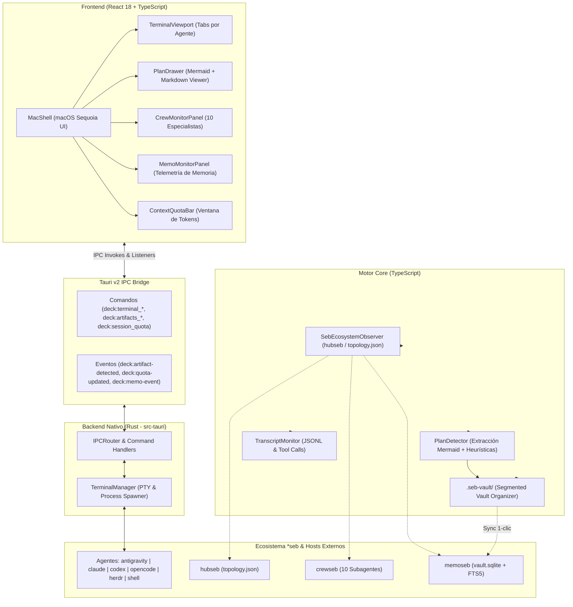

# deckseb

Estación de control de escritorio (**100% opcional**), hub de terminales PTY y visor pasivo de telemetría para el ecosistema `*seb` ([**hubseb**](https://github.com/PahesebPJ/hubseb), [**crewseb**](https://github.com/PahesebPJ/crewseb), [**memoseb**](https://github.com/PahesebPJ/memoseb)).

Desarrollada sobre **Tauri v2 + React 18 + TypeScript**, con soporte multiplataforma (Linux, macOS, Windows) y un diseño nativo pulido con estética **macOS Sequoia** en **Modo Claro** y **Modo Oscuro**.

---

## 💡 Filosofía: 100% Opcional y Modo Pasivo

`deckseb` fue concebido bajo el principio de **cero acoplamiento obligatorio**:

- **Autonomía Total del CLI:** [**hubseb**](https://github.com/PahesebPJ/hubseb), [**crewseb**](https://github.com/PahesebPJ/crewseb) y [**memoseb**](https://github.com/PahesebPJ/memoseb) operan de forma 100% autónoma en cualquier consola o entorno headless sin requerir `deckseb`.
- **Cero Mutaciones en Repositorios Adyacentes:** `deckseb` funciona en modo de solo lectura sobre las configuraciones del sistema y los logs de transcripción de los agentes. Solo escribe en su propia bóveda de artefactos local (`.seb-vault/`) o en `topology.json` si se invoca explícitamente `deckseb setup`.
- **Nodo Hoja Desacoplable:** En la topología de `hubseb`, `deckseb` se registra opcionalmente como un nodo hoja observador (`ui.deck`, `artifacts.organizer`). Si se desinstala o purga (`deckseb purge`), el resto del ecosistema continúa ejecutándose sin notar su ausencia.

---

## 🏛️ Arquitectura

`deckseb` combina un frontend reactivo con un backend nativo en Rust a través de los canales IPC asíncronos de Tauri v2:



### Componentes de la Arquitectura

1. **Terminal Hub Multisesión (`TerminalManager` / `TerminalViewport`):**
   Permite lanzar e interactuar simultáneamente con terminales dedicadas a los 6 entornos compatibles:
   - `antigravity` (`agy`)
   - `claude` (Claude Code)
   - `codex` (Codex CLI)
   - `opencode` (OpenCode CLI)
   - `herdr` (Herdr orchestrator)
   - `shell` (Bash / Zsh estándar)
2. **Detector de Artefactos y Drawer Interactivo (`PlanDetector` / `PlanDrawer`):**
   Monitorea en tiempo real el flujo de las sesiones. Al detectar planes de implementación, criterios de aceptación o bloques de código `mermaid`, despliega automáticamente el panel lateral (`PlanDrawer`) para renderizar y navegar los diagramas visualmente sin interferir con la terminal.
3. **Bóveda Segmentada Local (`.seb-vault/`):**
   Clasifica los artefactos detectados en 5 categorías persistentes (`plans`, `diagrams`, `specs`, `reviews`, `post-mortems`), extrayendo diagramas individuales a archivos `.mmd`.
4. **Sincronización en 1 Clic con `memoseb`:**
   Permite enviar cualquier plan, decisión o arquitectura descubierta directamente a la bóveda vectorial/FTS5 de `memoseb` mediante `memoseb remember`.
5. **Observador Pasivo de Ecosistema (`SebEcosystemObserver`):**
   Lee las configuraciones de `~/.config/hubseb/topology.json`, perfiles de modelos (`crewseb-models.json`), identidades aleatorias (`crewseb-personas.json`) y métricas de `memoseb` (`vault.sqlite`), reflejando el estado en vivo de la tripulación y la GPU.
6. **Medidor de Cuota y Ventana de Contexto (`ContextQuotaBar`):**
   Calcula en tiempo real los tokens de entrada/salida y el porcentaje restante de la ventana de contexto de cada sesión activa, alertando ante riesgos de saturación (`healthy`, `warning`, `critical`).

---

## 📁 Bóveda de Artefactos Segmentada (`.seb-vault/`)

Cuando un agente o desarrollador genera un plan o documento de diseño, `deckseb` lo detecta mediante análisis léxico y de ruta (`classifyArtifactSegment`) y lo archiva automáticamente en el directorio raíz del proyecto:

```
.seb-vault/
└── <project-slug>/
    ├── manifest.json              # Metadatos, marcas de tiempo y sincronización con memoseb
    ├── plans/                     # Planes de implementación, roadmaps y matrices de despacho
    │   └── 2026-11-01-initial-architecture.md
    ├── diagrams/                  # Diagramas Mermaid (.mmd) extraídos automáticamente
    │   ├── 2026-11-01-initial-architecture-diagram-1.mmd
    │   └── 2026-11-01-initial-architecture-diagram-2.mmd
    ├── specs/                     # Especificaciones técnicas, BDD, Given/When/Then
    │   └── authentication-spec.md
    ├── reviews/                   # Reportes de code review y auditorías de seguridad
    │   └── pr-42-security-review.md
    └── post-mortems/              # Análisis de causa raíz (RCA) y revisiones de incidentes
        └── incident-2026-11-db-lock.md
```

### Segmentos de Clasificación Automática

| Segmento | Patrones en Rutas | Palabras Clave y Encabezados |
|---|---|---|
| `plans` | `plan`, `roadmap` | `# Implementation Plan`, `Plan de Implementación`, matrices de despacho |
| `diagrams` | `diagram`, `.mmd` | Bloques ` ```mermaid `, `graph TD`, `sequenceDiagram`, `flowchart` |
| `specs` | `spec`, `bdd`, `.feature` | `Scenario:`, `Given/When/Then`, `# Technical Specification` |
| `reviews` | `review`, `audit` | `# Code Review`, `# Security Audit`, auditorías de diff |
| `post-mortems` | `post-mortem`, `postmortem`, `rca` | `# Root Cause Analysis`, `# Incident Post-Mortem` |

---

## 🖥️ Experiencia de Usuario macOS Sequoia

`deckseb` incorpora una interfaz de usuario inspirada en el lenguaje de diseño de **macOS Sequoia**:
- **Ventana con Semáforo Nativo:** Botones de control (Cerrar, Minimizar, Expandir) integrados en la barra de herramientas.
- **Soporte Dinámico de Temas:** Conmutación instantánea entre **Modo Oscuro** (paleta obsidian/grafito profundo) y **Modo Claro** (vidrio translúcido y grises neutros de alto contraste).
- **Inspector Lateral Multifunción:** Pestañas superiores para alternar rápidamente entre:
  - 📋 **Planes & Diagramas:** Visualizador de Markdown y renderizador interactivo Mermaid.
  - 👥 **Tripulación (`crewseb`):** Estado de los 10 especialistas (`researcher`, `analyst`, `architect`, `developer`, `qa-automation`, `devops`, `sre`, `security`, `code-reviewer`, `documenter`), sus nombres propios aleatorios, worktrees activos y niveles de razonamiento (`fast`, `balanced`, `deep`).
  - 🧠 **Memoria (`memoseb`):** Monitor de eventos de memoria en vivo y conteo global de recuerdos indexados.

---

## 🚀 Instalación y Puesta en Marcha

### Instalación Rápida vía npm (Recomendado)

```sh
npm install -g deckseb
deckseb setup
```

### Instalación desde Código Fuente (Desarrollo Local)

```sh
# Clonar repositorio
git clone https://github.com/PahesebPJ/deckseb.git
cd deckseb

# Instalar dependencias y compilar CLI
npm install
npm run build

# Enlazar binario local
chmod +x dist/cli/deckseb.js
ln -sf "$(pwd)/dist/cli/deckseb.js" ~/.local/bin/deckseb

# Registrar nodo en hubseb (opcional)
deckseb setup
```

### Ejecución en Modo Aplicación de Escritorio

Para iniciar la aplicación de escritorio en modo desarrollo con recarga en caliente:

```sh
npm run tauri dev
```

O compilar el paquete ejecutable nativo para tu sistema operativo:

```sh
npm run tauri build
```

---

## ⌨️ Referencia de Comandos CLI

El ejecutable `deckseb` provee herramientas de diagnóstico, integración con `hubseb` y detección local de artefactos:

```sh
deckseb status [--json]    # Inspecciona el estado del ecosistema *seb, topología y subagentes
deckseb setup              # Registra deckseb como nodo hoja (ui.deck) en hubseb topology.json
deckseb purge              # Elimina deckseb de topology.json limpiamente
deckseb detect <archivo>   # Analiza un archivo Markdown y extrae planes y diagramas Mermaid
deckseb --version          # Muestra la versión instalada
deckseb --help             # Despliega la ayuda del comando
```

### Resumen de Nodos y Capacidades en `topology.json`

Al ejecutar `deckseb setup`, se registra la siguiente tarjeta de capacidad en `~/.config/hubseb/topology.json`:

| Propiedad | Valor |
|---|---|
| **ID del Nodo** | `deckseb` |
| **Provides** | `ui.deck`, `artifacts.organizer` |
| **Consumes** | `memory.vault`, `crew.specialists`, `crew.models` |
| **Signals** | `deck.launched`, `artifact.detected` |
| **Tipo de Nodo** | Hoja pasiva (Leaf Node) |

---

## 🧪 Verificación y Suite de Pruebas

Para validar la integridad de la aplicación (frontend TypeScript, suite de integración y backend en Rust), ejecuta:

```sh
# Verificación de tipos TypeScript
npm run typecheck

# Suite de pruebas TypeScript (Node.js Test Runner)
npm test

# Suite de pruebas de la librería nativa Rust
(cd src-tauri && cargo test)

# Verificación completa combinada
npm run typecheck && npm test && (cd src-tauri && cargo test)
```

---

## 📄 Licencia

MIT © [PahesebPJ](https://github.com/PahesebPJ)
